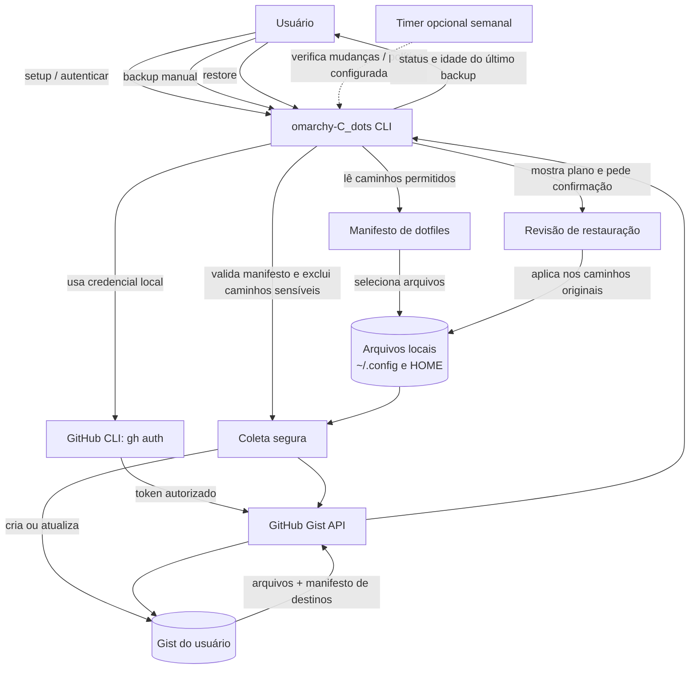

# Arquitetura do fluxo de dotfiles

O diagrama mostra o MVP planejado. A ferramenta roda localmente, usa a autenticação GitHub do usuário via `gh`, e mantém os arquivos nos caminhos originais. O Gist funciona como cópia remota versionada, não como pasta de trabalho.

## Regras do MVP

- Backup manual por padrão; timer semanal é opt-in.
- Um Gist por usuário, associado localmente após autenticação.
- O manifesto lista caminhos relativos ao `HOME`; não varrer `~/.config` inteiro.
- Excluir segredos, tokens, caches, arquivos de sessão, binários e configurações específicas de hardware por padrão.
- Avisar que Gist secreto é acessível a qualquer pessoa que obtenha o link.
- Mostrar os arquivos que serão sobrescritos e pedir confirmação antes de restaurar.
- Registrar localmente a data do último backup para `status` e alertas de backup antigo.
