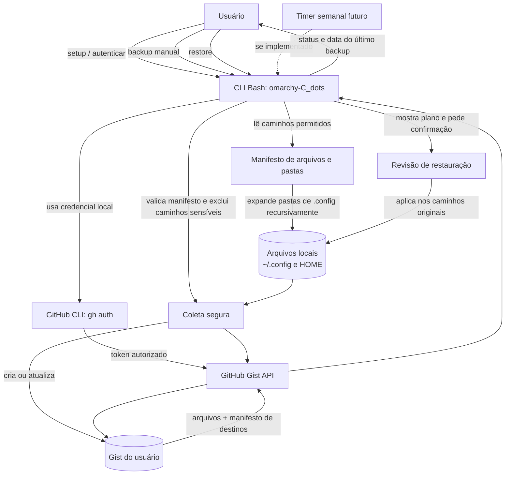

# Arquitetura do fluxo de dotfiles

O diagrama mostra o MVP em Bash. A ferramenta roda localmente, usa `jq` para montar o pacote e a autenticação GitHub do usuário via `gh`, e mantém os arquivos nos caminhos originais. O Gist funciona como cópia remota versionada, não como pasta de trabalho. O timer semanal permanece como possibilidade futura.

## Regras do MVP

- Backup manual; timer semanal ainda não implementado.
- Um Gist por usuário, associado localmente após autenticação.
- O manifesto lista caminhos relativos ao `HOME`; não varrer `~/.config` inteiro.
- Entradas podem ser arquivos individuais ou subpastas específicas de `~/.config`; pastas são percorridas recursivamente.
- Não seguir links simbólicos; pular caches, sessões, dependências e diretórios Git.
- Limitar o pacote completo a 900 KB para caber em um único arquivo do Gist.
- Ignorar caminhos sensíveis conhecidos, caches, arquivos de sessão, binários e links simbólicos.
- Revisar a prévia: configurações específicas de hardware dentro de uma pasta selecionada também serão sincronizadas.
- Avisar que Gist secreto é acessível a qualquer pessoa que obtenha o link.
- Mostrar os arquivos que serão sobrescritos e pedir confirmação antes de restaurar.
- Registrar localmente a data do último backup para `status`.
